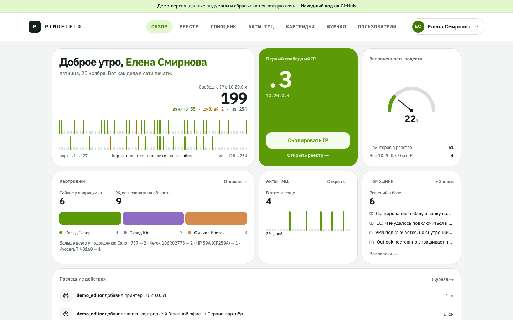
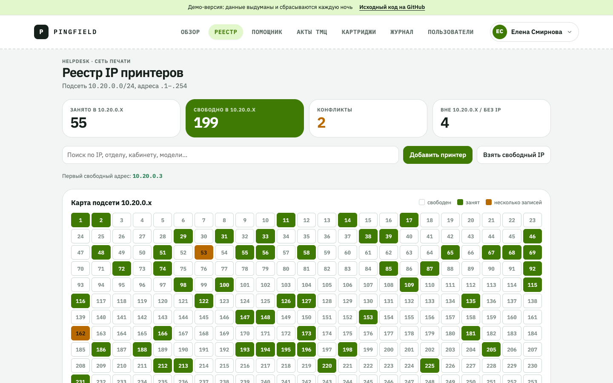
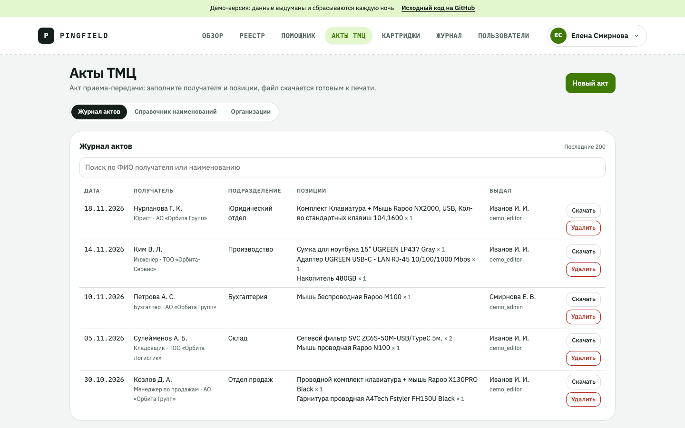
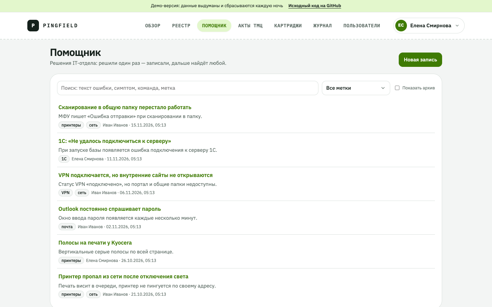
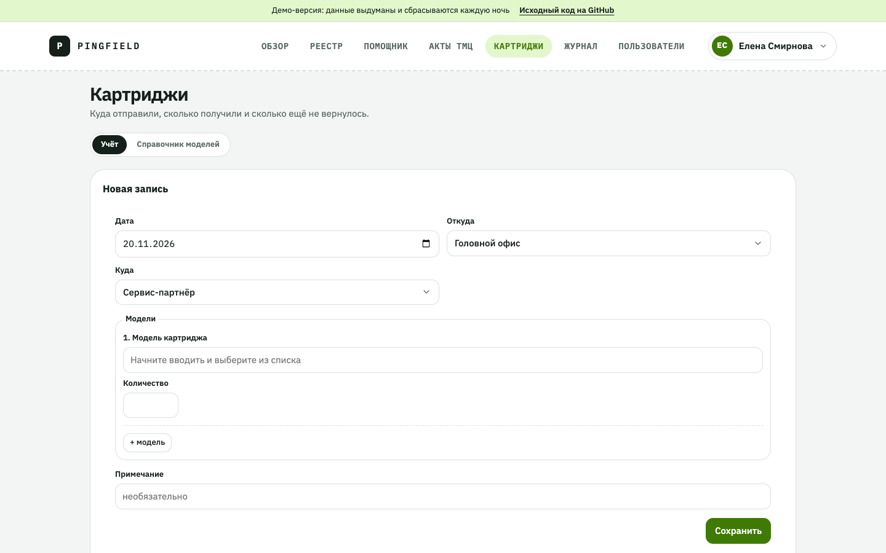
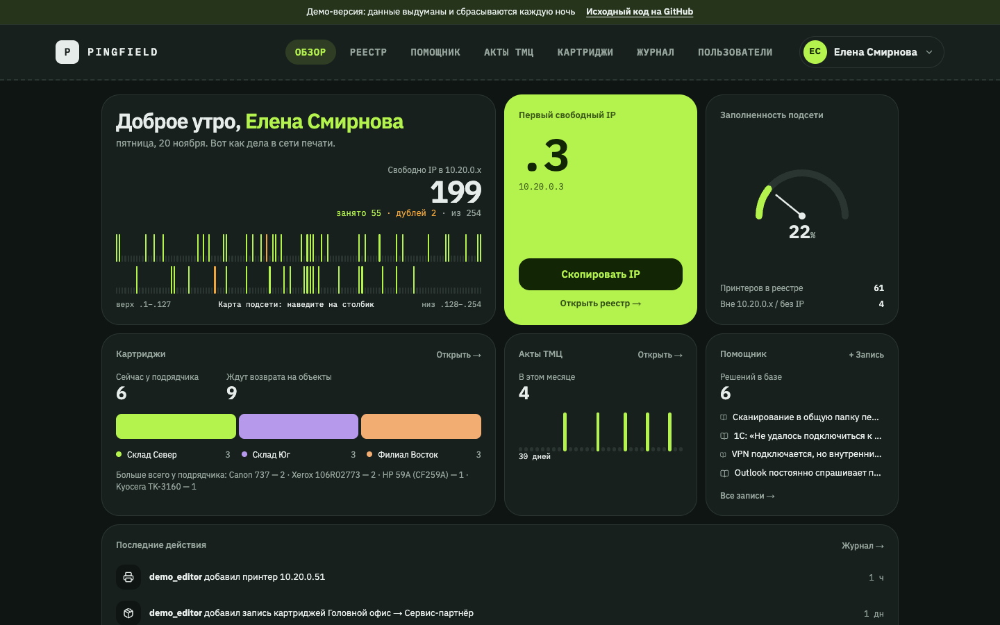
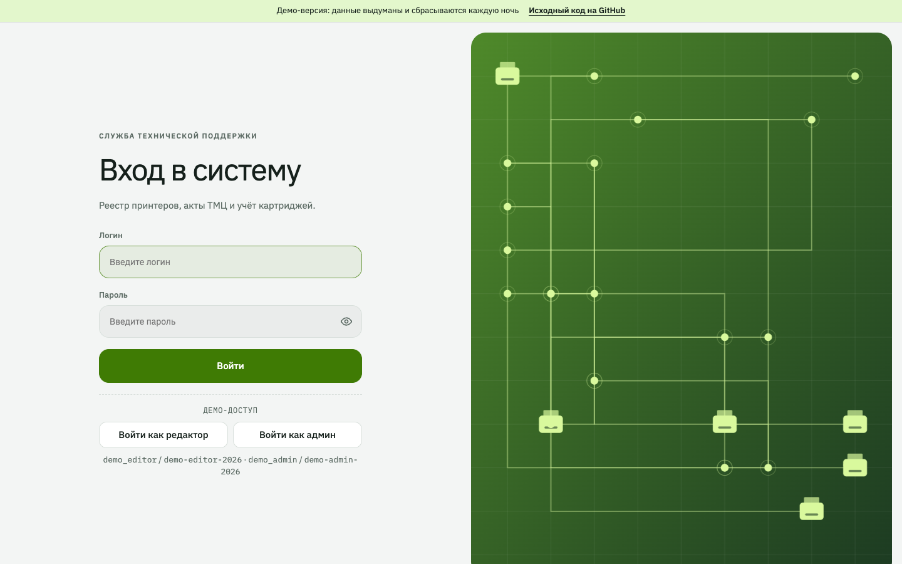

# Pingfield — demo

**Pingfield** is an internal helpdesk tool for a company's print network: an IP registry of printers with a live subnet map, equipment hand-over acts (exported to Excel), cartridge tracking between sites and a contractor, and a small knowledge base for the IT team.

This repository is a **public demo** of a tool that runs in production at a real company. All data here is fictional (the company "Орбита", subnet `10.20.0.0/24`), and the demo database is reset every night.

**Live demo:** _link will be added after deployment_ — sign in with one click as an editor or an admin.



## Features

- **Overview** — free addresses, first free IP, subnet fill, cartridges at the contractor, recent activity.
- **IP registry** — 254-cell subnet map, conflicts (one IP, several records), search, add/edit with an audit trail.
- **Equipment acts (ТМЦ)** — form with a catalog of items (photos, sections), generates a print-ready `.xlsx` act (two copies on A4) from a template.
- **Cartridges** — moves between sites, the head office and a refilling contractor; write-offs on return; reports per site.
- **IT helper** — knowledge base in Markdown, pasted screenshots, attachments, tags, search, archive, edit conflict protection.
- **Users and roles** — viewer / editor / admin, bcrypt, login throttling per login and IP, sessions invalidated on logout and access changes.
- **Audit log** of every change; light and dark themes.

| Registry | Acts | Helper |
|---|---|---|
|  |  |  |

| Cartridges | Dark theme | Sign-in |
|---|---|---|
|  |  |  |

## Stack

Next.js 16 (App Router, route handlers) · React 19 · TypeScript · Neon serverless Postgres · Vercel (hosting + Cron) · ExcelJS · plain CSS (no UI kit) · `node:test`.

## Demo specifics

- Two public accounts: `demo_editor` / `demo-editor-2026` and `demo_admin` / `demo-admin-2026`. Their role, active flag and password cannot be changed, so one visitor cannot lock out the next.
- Attachments: up to 1 MB each, 50 MB in total.
- Every night at 03:00 (Almaty) Vercel Cron calls `/api/demo/reset`, which wipes all tables and loads the demo data again in one transaction (`src/lib/demo/seed.ts`).

## Run locally

```bash
npm ci
cp .env.example .env.local   # DATABASE_URL, SESSION_SECRET, CRON_SECRET
npm run db:setup             # creates tables and loads the demo data
npm run dev
```

Tests: `npm test` (unit), `npm run e2e` (against a local Postgres behind a Neon HTTP proxy, see `scripts/e2e-demo.mjs`).

## Deploy

1. Create a Neon project and copy the pooled connection string.
2. Import this repository into Vercel and set `DATABASE_URL`, `SESSION_SECRET` (`openssl rand -base64 48`) and `CRON_SECRET` (`openssl rand -hex 24`).
3. Run `npm run db:setup` once with that `DATABASE_URL`. The nightly cron from `vercel.json` takes it from there.

---

## По-русски

Pingfield — внутренний инструмент службы техподдержки: реестр IP-адресов принтеров с картой подсети, акты приёма-передачи ТМЦ с выгрузкой в Excel, учёт картриджей между площадками и подрядчиком, база решений IT-отдела.

Это публичная демо-версия. Настоящая работает в компании, а здесь все данные выдуманы (компания «Орбита», подсеть `10.20.0.0/24`) и каждую ночь сбрасываются. Войти можно одной кнопкой как редактор или как администратор.
